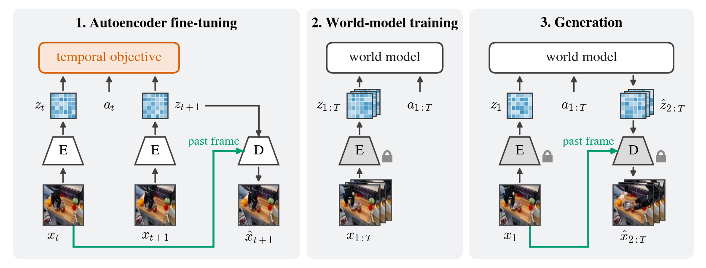
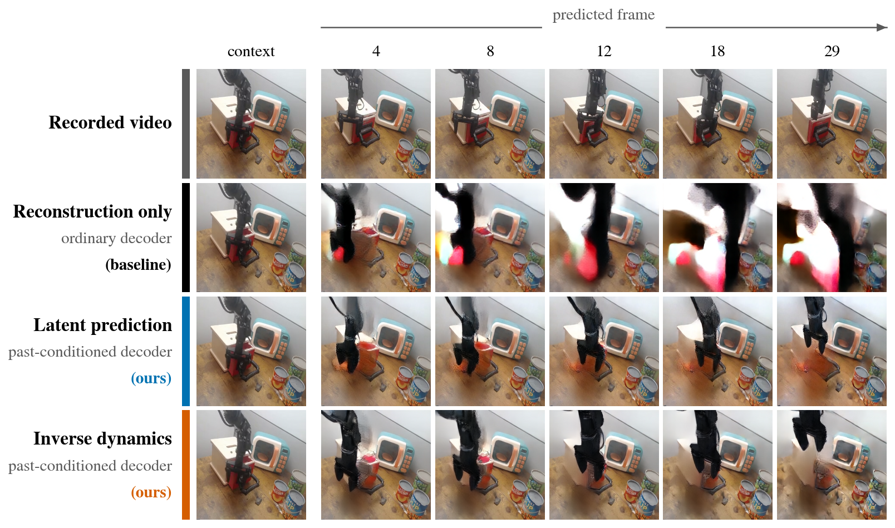

# Video World Models Need Predictable Latents

Mattia Scardecchia, Sherry Yang

New York University

Paper: [arXiv:2610.34663](https://arxiv.org/abs/2610.34663)



*Our recipe for video world models. (1) The autoencoder is fine-tuned on nearby frames with a
reconstruction loss and a temporal objective on the latents and the action between them (orange); its
decoder reconstructs each frame conditioned on the previous one (green). (2) An action-conditioned
diffusion world model is trained on the latents of the frozen encoder. (3) From a context frame and a
sequence of actions, the world model generates latents, which the decoder turns into frames.*



*World models trained on reconstruction latents (baseline) and on our latents (latent
prediction or inverse dynamics, with the past-conditioned decoder). One AutoEval trajectory,
out of distribution: the recorded actions are replayed from one context frame for three times the length
of the training clips, with 2 sampling steps.*

This repository contains the code for the paper: fine-tuning video autoencoders with temporal
objectives, and training and evaluating latent video world models on them.

## Installation

Python 3.11 or newer is required; training the video models requires a CUDA GPU.

```sh
pip install -e '.[evaluation,worldgym]'
```

Download the pretrained weights (the FLUX.1-schnell autoencoder, DINOv2 and the metric networks).
The FLUX weights require accepting their terms on
[Hugging Face](https://huggingface.co/black-forest-labs/FLUX.1-schnell) and logging in to Hugging
Face, for example with `hf auth login`.

```sh
python -m wm_repr.assets --output assets
```

## Data

Training and in-distribution evaluation use [Bridge V2](https://rail-berkeley.github.io/bridgedata/).
Download the TFDS release `bridge_dataset/1.0.0` from the
[Bridge data server](https://rail.eecs.berkeley.edu/datasets/bridge_release/data/tfds/bridge_dataset/1.0.0/)
and convert it:

```sh
pip install -e '.[conversion]'
python -m wm_repr.data.prepare --builder-dir /path/to/bridge_dataset/1.0.0 --output data
```

Out-of-distribution evaluation uses 500 real-robot trajectories that
[World-Gymnast](https://world-gymnast.github.io/) recorded on the [AutoEval](https://auto-eval.github.io/)
robot stations. They come from the [AutoEval dataset](https://huggingface.co/datasets/zhouzypaul/auto_eval)
(MIT licence), converted to videos and action files. The evaluation uses the 479 trajectories with
at least 50 frames:

```sh
curl -L https://github.com/mattia-scardecchia/predictable-latents/releases/download/v1.0/autoeval.tar.gz | tar -xz -C data
```

## Training

Training has two stages: fine-tune the autoencoder, then train a world model on its frozen
latents.

```sh
python -m wm_repr.train --recipe matched_budget_latent --stage ae --seed 1234 --output outputs/ae
python -m wm_repr.train --recipe matched_budget_latent --stage wm --seed 1234 --ae-checkpoint outputs/ae/last.ckpt --output outputs/wm
```

Each recipe in `src/wm_repr/configs/recipes` sets up one experiment of the paper:

| Recipes | Experiment |
|---|---|
| `matched_reconstruction_{reconstruction,latent,pixel,contrastive}` | Temporal objectives at matched reconstruction error |
| `frontier_{ordinary,conditioned}` | Reconstruction–predictability trade-off, ordinary or past-conditioned decoder |
| `matched_budget_{ordinary,reconstruction,latent,inverse}`, `pretrained` | Temporal objectives at matched training budget; `pretrained` trains only the world model, on the untuned FLUX autoencoder |
| `dino` | DINOv2 representation autoencoder |
| `kl_reconstruction`, `kl_latent` | KL penalty on the latents |
| `longer` | Longer world-model training, for latent prediction; the other two arms continue `matched_budget_reconstruction` and `matched_budget_inverse` with `--resume outputs/wm/last.ckpt --set training.trainer.max_steps=200000` |
| `size_large` | Larger world model, for latent prediction; the reconstruction arm is `matched_budget_reconstruction` with `--set model.model_dim=1024 --set model.layers=16 --set model.heads=16 --set training.trainer.max_steps=200000` |

`--set key=value` overrides any setting. The weight of the temporal objective is
`model.encoder.future_pred_weight` for latent prediction, `future_recon_weight` for pixel
prediction, `contrastive_loss_weight` for contrastive prediction and `inverse_weight` for inverse
dynamics, all under `model.encoder`; for example, `--set model.encoder.future_pred_weight=0.3`.
`--print-config` shows the resolved configuration, and `--resume outputs/wm/last.ckpt` continues a
run.

## Evaluation

Build the fixed evaluation sets once:

```sh
python -m wm_repr.data.manifests --data-root data --autoeval-root data --output manifests
```

World-model rollouts:

```sh
python -m wm_repr.evaluation --checkpoint outputs/wm/last.ckpt --ae-checkpoint outputs/ae/last.ckpt --assets assets --data-root data --mode id --manifest manifests/bridge_id_2000.jsonl --output results/id
```

| `--mode` | `--manifest` | Evaluation |
|---|---|---|
| `id` | `bridge_id_2000.jsonl` | Held-out Bridge clips; add `--distribution-metrics` for FID and FVD |
| `ood` | `autoeval_all_479.jsonl` | AutoEval trajectories |
| `steps` | `bridge_steps_512.jsonl` | Number of sampling steps |
| `drift` | `bridge_drift.jsonl` | Long rollouts |
| `controls` | `bridge_id_2000.jsonl` | Shuffled actions and the reconstruction ceiling |
| `forecast` | `bridge_control_256.jsonl` | One-step latent forecasts |

Out of distribution, add `--split ood` and use `autoeval_all_479.jsonl` for `controls` and
`autoeval_control_256.jsonl` for `forecast`.

Autoencoder only, with `--mode reconstruction`, `interventions` (the decoder's use of the past
frame), `dump` (latents for the predictability analysis, on `bridge_id_2000.jsonl`) or `geometry`:

```sh
python -m wm_repr.evaluation.autoencoder --checkpoint outputs/ae/last.ckpt --assets assets --data-root data --mode reconstruction --output results/reconstruction
```

## Latent analyses

```sh
python -m wm_repr.evaluation.autoencoder --checkpoint outputs/ae/last.ckpt --assets assets --data-root data --mode dump --manifest manifests/bridge_id_2000.jsonl --output results/ae-dump
python -m wm_repr.analysis.predictability --dump results/ae-dump --output results/predictability
python -m wm_repr.analysis.structure --latents results/geometry/raw_latents.npy --pixel-angles results/geometry/pixel_turning_angles.npy --output results/structure
```

`wm_repr.analysis.statistics` computes the training-curve crossings from validation values (one row
per pipeline, seed, update and metric), and `wm_repr.analysis.aggregate` averages results over
seeds; see `--help`.

## Synthetic study

Runs on CPU:

```sh
python -m wm_repr.toy --output outputs/toy
```

## Policy evaluation in WorldGym

Rollouts run the policies through [WorldGym](https://github.com/world-model-eval/world-model-eval)'s
scripts. Follow its setup for the policies and starting observations, using commit
`709665b29f5c95124e7dbc05b0d4d47cd353de97`. In each policy environment, install this package
with `pip install --no-deps -e . && pip install pytorch-lightning==2.5.5 omegaconf==2.3.0 mediapy`
and add `world-model-eval/src` to `PYTHONPATH`. Then generate rollouts for each policy (`openvla`,
`octo` or `rt1`), judge them with Claude through the
[Claude Code CLI](https://docs.claude.com/en/docs/claude-code), and summarize. The judge uses
WorldGym's prompt unchanged, with three responses per rollout:

```sh
python -m wm_repr.worldgym.rollout --checkpoint outputs/wm/last.ckpt --ae-checkpoint outputs/ae/last.ckpt --assets assets --root-dir worldgym-data --policy openvla --output rollouts/openvla
python -m wm_repr.worldgym.judge --rollout-dir rollouts/openvla
python -m wm_repr.worldgym --results rollouts/{openvla,octo,rt1}/results.json --output results/worldgym.json
```

The summary gives Pearson r and Spearman ρ with their bootstrap standard errors over tasks; add
`--compare` with a reference world model's three `results.json` for the paired difference in
pooled r and its p-value. RT-1-X also needs `--rt1-checkpoint-path`. To measure the judge's
accuracy on 48 real AutoEval episodes with human labels:

```sh
python -m wm_repr.worldgym.calibration prepare --manifest worldgym-calibration.json --video-root data/autoeval_rollout_trajectories_splitted_4_all/test --output results/calibration
python -m wm_repr.worldgym.judge --rollout-dir results/calibration
python -m wm_repr.worldgym.calibration summary --manifest worldgym-calibration.json --judgements results/calibration/judgements.jsonl --output results/calibration/accuracy.json
```

## Citation

```bibtex
@article{scardecchia2026predictable,
  title   = {Video World Models Need Predictable Latents},
  author  = {Scardecchia, Mattia and Yang, Sherry},
  journal = {arXiv preprint arXiv:2610.34663},
  year    = {2026}
}
```

## Licence

MIT ([LICENSE](LICENSE)). Files adapted from other projects state their origin in a header.

## Acknowledgements

- [WorldGym](https://github.com/world-model-eval/world-model-eval)
- [RAE](https://github.com/bytetriper/RAE)
- [latent-diffusion](https://github.com/CompVis/latent-diffusion)
- [taming-transformers](https://github.com/CompVis/taming-transformers)
- [World-Gymnast](https://world-gymnast.github.io/) and [AutoEval](https://auto-eval.github.io/), for the out-of-distribution trajectories
